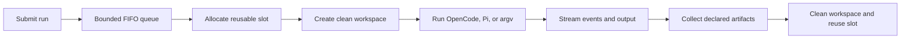

# Agentic Sandbox

[](https://github.com/darsh0230/agentic-sandbox/actions/workflows/ci.yml)
[](LICENSE)
[](ROADMAP.md)
[](https://deepwiki.com/darsh0230/agentic-sandbox)

**A self-hosted Rust runtime for running coding agents in reusable, isolated
Linux workspaces.** Run OpenCode, Pi, and shell-based agents with streamed
output, artifact collection, queueing, and per-run network credentials.

> [!WARNING]
> Agentic Sandbox is experimental, isolation-focused infrastructure—not a
> production-hardened hostile-multitenant sandbox. It does not yet enforce CPU,
> memory, or process-count limits, and its PID and network boundaries remain
> shared. Read the [security model](docs/security.md) before running untrusted
> workloads.

[Documentation](docs/README.md) · [Security](SECURITY.md) ·
[Examples](examples/README.md) · [Roadmap](ROADMAP.md) ·
[Contributing](CONTRIBUTING.md) · [Releases](docs/releasing.md)

## Quick start

Requirements:

- Docker with Compose
- A Linux container host, or Docker Desktop's Linux VM, for the isolation
  features

Start the lower-privilege user-isolation profile with the published image:

```bash
docker compose --profile user up agentic-sandbox-user
```

Open <http://127.0.0.1:8080> and use the development token
`change-me-dev-token`.

The image contains both
[OpenCode](https://opencode.ai/) and
[Pi Coding Agent](https://pi.dev/). To send OpenCode a small repository, ask it
to fix a failing test, stream its output, and download the patch:

```bash
AGENT_API_KEY_NAME=ANTHROPIC_API_KEY \
AGENT_API_KEY='your-provider-key' \
./examples/opencode-fix-issue/run.sh
```

Use the environment-variable name expected by your chosen OpenCode provider and
optionally set `OPENCODE_MODEL=provider/model`. The example never writes the key
into the repository, but it does send it over the loopback development API.

A successful run streams slot and agent output, then saves:

```text
examples/opencode-fix-issue/output/
├── agent.patch
├── result.json
└── test-output.txt
```

See [Examples](examples/README.md) for a Pi API-building task, repository review,
and parallel agent runs.

### Other startup modes

Privileged isolation adds mount, IPC, and UTS namespaces and requires
`SYS_ADMIN`:

```bash
docker compose --profile privileged up agentic-sandbox-privileged
```

Build the current checkout instead of using the published image:

```bash
docker compose --profile user up --build agentic-sandbox-user
```

The Compose file is intended for local evaluation. Change the token before
sharing the service, keep the HTTP listener bound to loopback, and start only one
profile because both use the same port and state volume. Before the first GHCR
release exists, Compose falls back to building the checked-in Dockerfile.

Stop the active profile with:

```bash
docker compose --profile user down
```

## What it provides

- Bounded FIFO scheduling across reusable sandbox slots
- Privileged isolation using mount, IPC, and UTS namespaces plus `pivot_root`
- Lower-privilege user isolation using a dedicated UID/GID per active slot
- Unix-socket control API and an optional browser/HTTP development API
- Streaming stdout, stderr, lifecycle events, and 15-second heartbeats
- Input-file injection and explicit result/artifact collection
- Per-run timeouts, disconnect cancellation, and cleanup policies
- Graceful SIGINT/SIGTERM forwarding to active slot process groups
- Run-scoped outbound proxy credentials, header overrides, upstream proxy
  routing, and optional HTTPS interception

The runtime follows this lifecycle:



## Minimal API example

With a Compose service running:

```bash
curl --no-buffer \
  -H 'Authorization: Bearer change-me-dev-token' \
  -H 'Content-Type: application/json' \
  --data '{
    "run_id": "hello-001",
    "command": [
      "bash",
      "-lc",
      "mkdir -p output; echo hello; printf \"{\\\"status\\\":\\\"ok\\\"}\" > result.json; echo done > output/result.txt"
    ],
    "result_policy": {
      "collect_paths": ["output/result.txt"],
      "result_file": "result.json"
    }
  }' \
  http://127.0.0.1:8080/api/run
```

The response is newline-delimited JSON containing lifecycle events, output,
heartbeats, and a final result.

## Documentation

- [Runtime and configuration](docs/runtime.md)
- [API reference](docs/api.md)
- [Architecture](docs/architecture.md)
- [Outbound proxy](docs/proxy.md)
- [Security model and known limitations](docs/security.md)

## Supported platforms

| Environment | Status | Notes |
| --- | --- | --- |
| Linux kernel 5.6+ with Docker | Supported target | Required for `openat2` and Linux isolation |
| GitHub-hosted Ubuntu runner | Continuously tested | Rust suite plus user and privileged Docker E2E |
| macOS with Docker Desktop | Local evaluation | Runs through Docker's Linux VM; host-native isolation is unavailable |
| Windows with Docker Desktop | Not validated | Linux-container mode may work, but is not in CI |
| Linux `amd64` image | Published release target | GHCR workflow currently builds this platform |
| Linux `arm64` image | Not yet published | Track multi-architecture work in the roadmap |

## Development and verification

CI checks formatting, Clippy with warnings denied, the complete Rust test suite,
both Compose profiles, example shell syntax, and Docker-backed E2E coverage for
both isolation modes. Run the local equivalents with:

```bash
cargo fmt --all -- --check
cargo clippy --locked --all-targets --all-features -- -D warnings
cargo test --locked --all-targets
docker compose --profile user config --quiet
docker compose --profile privileged config --quiet
find examples -type f -name '*.sh' -print0 | xargs -0 -n1 bash -n
```

The Docker E2E suite validates HTTP authentication, artifacts, timeouts,
queueing, heartbeats, disconnect cancellation, graceful shutdown forwarding,
process-tree cleanup, and slot reuse:

```bash
cargo test --locked --test docker_e2e -- --ignored --test-threads=1
```

It requires a working Docker daemon and takes over a minute because a queue test
waits for the production 15-second heartbeat.

## AI-assisted development disclosure

AI coding assistants have contributed to the code and documentation under human
direction and review. Changes are checked by automated formatting, linting,
unit/integration tests, and Docker E2E tests, but the project has not received an
independent external security audit.

Known security limitations are maintained in the
[security model](docs/security.md). Report vulnerabilities through
[GitHub's private security advisory form](https://github.com/darsh0230/agentic-sandbox/security/advisories/new).
Community review is especially welcome around namespace boundaries, seccomp,
capability handling, process cleanup, resource enforcement, API authorization,
and egress controls.

## License

Agentic Sandbox is available under the [MIT License](LICENSE).
