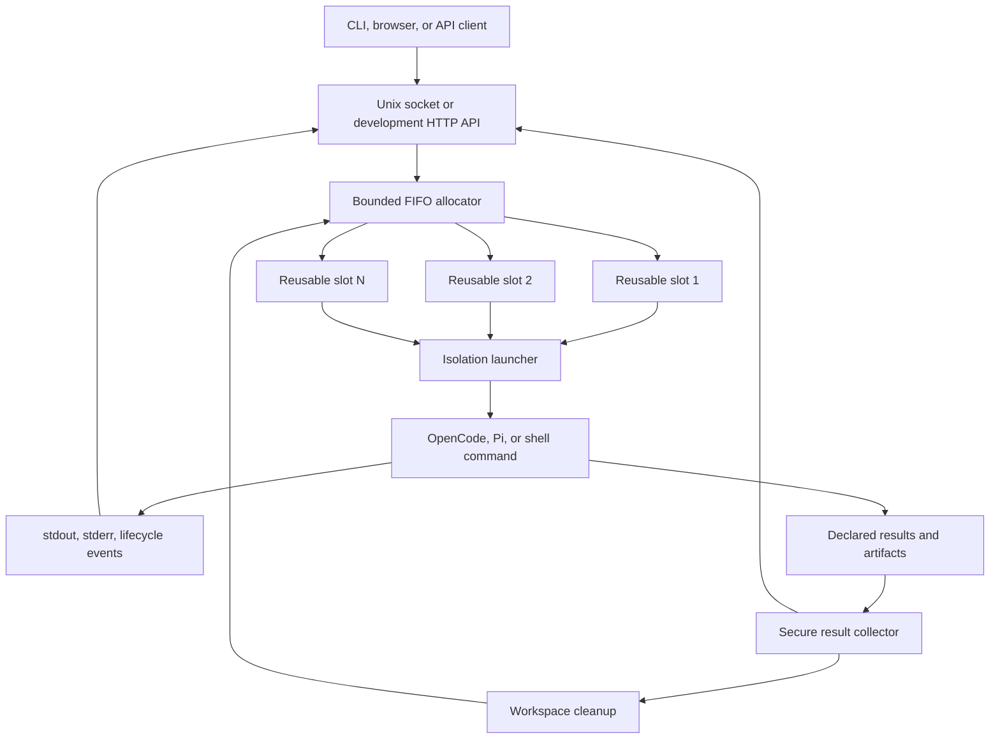

# Architecture

Agentic Sandbox is a single Rust process that supervises multiple coding-agent
runs inside one Linux container. It multiplexes work over a fixed set of slots,
creates a clean workspace for each run, starts the requested command with one of
two isolation modes, streams events, collects selected results, and then cleans up.



## Components

| Component | Responsibility |
| --- | --- |
| `src/api` | Unix-socket protocol, optional HTTP API, browser assets, streaming, and disconnect detection |
| `src/master` | Request validation, slot scheduling, workspace lifecycle, injection, supervision, result collection, and cleanup |
| `src/sandbox` | Linux namespace setup, synthetic root filesystem, UID/GID changes, capabilities, and child seccomp |
| `src/policy` | Constructs a clean child environment and blocks sensitive overrides |
| `src/proxy` | Authenticated run-scoped forward proxy, matching, header overrides, upstream routing, and optional TLS interception |
| `src/cgroup` | Reserved for cgroup v2 support; limits are not currently enforced |

The process itself runs as the trusted control plane. Agent commands are untrusted
children. Both currently share the container's PID and network namespaces with the
control plane; see the [security model](security.md) for the consequences.

## Run lifecycle

1. The API validates and deserializes an `AgentRunRequest`.
2. The allocator returns an available slot or adds the request to its bounded FIFO
   wait queue.
3. The workspace manager atomically moves aside any previous slot workspace,
   creates a fresh directory tree, and assigns it to the slot UID/GID.
4. Requested input files are written using validated relative paths.
5. The policy module creates a minimal environment. Caller-supplied sensitive
   environment variables are discarded.
6. If enabled, the proxy creates a random run-scoped credential and adds proxy
   environment variables to the child.
7. The launcher enters the selected isolation mode and executes the exact argv
   vector supplied by the request.
8. Stdout and stderr are streamed while bounded tail buffers are retained for the
   final result.
9. A timeout or client disconnect kills the child process group and then
   sweeps every remaining process owned by the slot's dedicated UID
   (pidfd-pinned SIGKILL, immune to PID reuse), so descendants that detached
   into their own session (`setsid`/`setpgid` are allowed) cannot outlive
   their run. The same UID sweep runs again before the slot is leased to the
   next run. A service SIGINT or SIGTERM is forwarded unchanged to every
   active child process group and is allowed to complete within the service
   shutdown grace period.
10. A child still running at the shutdown deadline is sent SIGKILL, followed by
    the same UID-scoped sweep.
11. Declared files and the optional result JSON file are collected.
12. The workspace is reset unless its cleanup policy preserves it.
13. The slot lease is returned to the FIFO allocator.

## Service shutdown

The trusted control plane owns a shutdown coordinator shared by the APIs,
allocator admission path, and run supervisors. The first SIGINT or SIGTERM
atomically stops new run admission, closes API listeners, cancels queued and
pre-launch work, and forwards that exact signal to every active slot process
group. Active HTTP and Unix streams remain alive while their runs handle the
signal and clean up.

Each admitted run holds a permit until result collection and workspace cleanup
finish. The service waits for all permits before exiting. At the configured
deadline, or when a second SIGINT/SIGTERM arrives, the coordinator transitions
to forced shutdown and supervisors send SIGKILL to remaining slot groups. Both
isolation modes use this same path; mount, IPC, and UTS namespaces do not affect
signal delivery because PID namespaces remain shared.

## Slot model

Slots are named `slot-0001`, `slot-0002`, and so on. Slot `n` maps to UID and GID
`10000 + n`; the default eight slots therefore use IDs `10001` through `10008`.
The container image pre-creates 64 such users, while the allocator accepts up to
4096 slots. Configuring more than 64 slots with the supplied image fails in user
isolation mode because the corresponding users do not exist.

When every slot is busy, requests wait in arrival order. The default wait limit is
ten requests per configured slot. A canceled waiter is removed immediately, and a
slot assigned during a cancellation race is handed to the next waiter.

## Isolation modes

### Privileged

Privileged mode is the default and performs the following child setup:

- creates a new mount, IPC, and UTS namespace;
- marks mount propagation private;
- builds a synthetic root filesystem under
  `/var/lib/agentic-sandbox/roots/<run-id>`;
- read-only binds runtime paths such as `/usr`;
- mounts private tmpfs instances for `/tmp`, `/var/tmp`, `/run`, and `/dev/shm`;
- binds the slot workspace to `/home/agent`;
- optionally binds caller-declared directories read-only;
- enters the root with `pivot_root`;
- mounts a new `/proc` view;
- changes to the slot UID/GID, requests capability bounding-set drops, enables
  `no_new_privs`, and loads the child seccomp filter.

This mode requires mount privileges such as `CAP_SYS_ADMIN`. It does **not** create
PID, network, or user namespaces.

### User

User mode avoids mount setup and `CAP_SYS_ADMIN`. It:

- uses the slot directory directly as the child's working directory and home;
- depends on pre-created per-slot users and `0700` workspace permissions;
- changes to the slot UID/GID;
- requests capability bounding-set drops, enables `no_new_privs`, and loads the
  child seccomp filter.

It does not hide the container filesystem, create namespaces, mount private
temporary filesystems, or support read-only directory injection. Use it only where
the weaker boundary is acceptable.

## Filesystem layout

The default runtime root is `/var/lib/agentic-sandbox`:

```text
/var/lib/agentic-sandbox/
├── state/       control socket, proxy config, CA material, setup errors
├── workspaces/  reusable per-slot workspaces
├── roots/       synthetic roots for privileged runs
├── injected/    reserved runtime directory
├── results/     reserved runtime directory
└── tombstones/  workspaces moved aside during reset
```

In privileged mode the workspace appears as `/home/agent` and `/workspace`.
In user mode the absolute host-side slot path remains visible to the child.

## Environment policy

The child process starts with an empty environment and a controlled baseline for
`HOME`, identity, `PATH`, temporary directories, XDG paths, and package-manager
caches. Request fields cannot override:

- identity, home, shell, path, or temporary-directory variables;
- dynamic-loader variables;
- Docker or Kubernetes control variables;
- proxy and proxy-CA variables;
- variables beginning with `AWS_`, `GCP_`, or `AZURE_`.

This is a deny-list intended to prevent common accidental leaks, not a complete
secret-discovery boundary.
