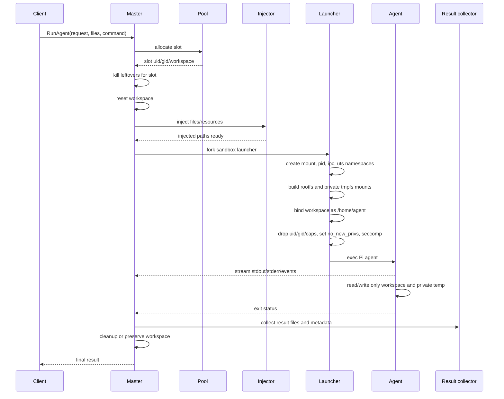

# implementation.md

# Single-container Pi-agent sandbox using Linux namespaces, per-agent users, private workspaces, and Rust

## 1. Goal

Build a Rust-based master application that can run multiple Pi agents inside one Docker container while keeping their files, temporary directories, processes, IPC objects, and writable state isolated from one another.

The master process is trusted and runs as root inside the container. Each agent run is untrusted relative to other agent runs. The master allocates a workspace, injects input resources/files, starts the agent in an isolated environment, streams intermediate output, collects final results, and then either preserves or cleans the workspace.

The desired user-facing behavior is:

```text
1. Client asks master to run a Pi agent.
2. Master allocates an available user/workspace slot.
3. Master injects files/resources into that workspace.
4. Master starts the agent with normal Linux tooling available:
   - ls
   - grep
   - bash
   - python3
   - other preinstalled tools
5. Agent can freely read/write inside its own workspace and private temp dirs.
6. Agent cannot read/write another agent's workspace.
7. Agent cannot share files through common /tmp, /run, or /dev/shm.
8. Agent output is streamed back to master.
9. Agent writes a final result or exits with stdout/stderr/status.
10. Master collects outputs and cleans/reuses the slot.
```

Network policy for this use case:

```text
Agents need outbound network access.
Agents may share the container's network namespace.
Do not create a per-agent network namespace in the first implementation.
Agents must not bind/listen on TCP, UDP, or Unix-domain socket endpoints in the MVP.
Enforce outbound-only behavior with a per-agent seccomp filter before execing the agent.
```

Important consequence: shared container networking keeps egress simple, but it is not a full network isolation boundary. The implementation must prevent agents from opening listening sockets by applying a per-agent seccomp policy that denies `bind()`, `listen()`, `accept()`, and `accept4()` before the agent command is executed. This still allows normal outbound client behavior such as DNS, HTTPS, Git, package downloads, and API calls.

Compatibility note: a simple seccomp rule that denies all `bind()` calls also denies Unix-domain socket bind operations. That is acceptable for the MVP if Pi/opencode do not need local Unix socket servers. If that breaks real workloads, replace the simple rule with a seccomp-user-notification broker or cgroup/eBPF policy that permits safe `AF_UNIX` sockets inside `/home/agent` or `/tmp` while continuing to deny TCP/UDP listening endpoints.

---

## 1.1 Build/run deliverable expectation

This plan now includes a Dockerfile, a development `docker run` command, and a Docker Compose example. However, the image will only run after the Rust master/launcher binary described in this file is implemented. The Dockerfile is the packaging contract; it is not a complete working product by itself.

Target developer flow after implementation:

```bash
docker build -t pi-sandbox:dev .
docker network create pi-sandbox-net || true
docker volume create pi-sandbox-state || true
docker run --rm -it \
  --name pi-sandbox \
  --network pi-sandbox-net \
  --cap-drop=ALL \
  --cap-add=SYS_ADMIN \
  --cap-add=SETPCAP \
  --cap-add=SETUID \
  --cap-add=SETGID \
  --cap-add=CHOWN \
  --cap-add=FOWNER \
  --cap-add=DAC_OVERRIDE \
  --cap-add=KILL \
  --security-opt seccomp=unconfined \
  --tmpfs /run:rw,nosuid,nodev,size=64m \
  --tmpfs /tmp:rw,nosuid,nodev,size=256m \
  -v pi-sandbox-state:/var/lib/pi-sandbox \
  pi-sandbox:dev
```

This default run command intentionally does **not** publish ports. The preferred control plane is a Unix socket or stdio/PTY/event stream that is not mounted into sandboxes. If a development HTTP API is needed, publish only the authenticated master API, for example `-p 127.0.0.1:8080:8080`, and assume agents can attempt to connect to it because they share the container network namespace.

Expected behavior after the code is implemented:

```text
1. The trusted master starts inside the container.
2. The master API receives an agent run request.
3. The master injects files/resources into a workspace.
4. The launcher creates namespaces, mounts, private temp dirs, and sanitized config.
5. The launcher drops to the slot UID/GID, drops capabilities, sets no_new_privs, and installs per-agent seccomp.
6. The Pi agent runs with normal tools and outbound network access only.
7. Agent attempts to bind/listen/accept on ports fail.
8. The master streams stdout/stderr/events and collects the final result.
9. Cleanup/reuse happens after the process tree is dead.
```

---

## 2. High-level architecture

```mermaid
flowchart TB
    Client[Client / API caller] --> API[Master API]

    subgraph Container[Single Docker container]
        API --> Master[Master daemon - trusted root process]

        Master --> Pool[Workspace + UID pool]
        Master --> Injector[Resource injector]
        Master --> Launcher[Sandbox launcher]
        Master --> Streamer[Stdout/stderr/PTY streamer]
        Master --> Results[Result collector]
        Master --> Cleanup[Cleanup/reaper]

        Pool --> SlotA[Slot A: uid 10001, gid 10001]
        Pool --> SlotB[Slot B: uid 10002, gid 10002]

        subgraph SandboxA[Agent sandbox A]
            MNSA[Mount namespace A]
            PIDA[PID namespace A]
            IPCA[IPC namespace A]
            NetA["Shared container network namespace<br/>outbound only; bind/listen denied"]
            FSA[Rootfs view A]
            TmpA[Private /tmp, /var/tmp, /run, /dev/shm]
            HomeA[/home/agent -> workspace A, rw]
            AgentA[Pi agent process, uid 10001, no caps]
        end

        subgraph SandboxB[Agent sandbox B]
            MNSB[Mount namespace B]
            PIDB[PID namespace B]
            IPCB[IPC namespace B]
            NetB["Shared container network namespace<br/>outbound only; bind/listen denied"]
            FSB[Rootfs view B]
            TmpB[Private /tmp, /var/tmp, /run, /dev/shm]
            HomeB[/home/agent -> workspace B, rw]
            AgentB[Pi agent process, uid 10002, no caps]
        end

        Launcher --> SandboxA
        Launcher --> SandboxB
        Streamer --> API
        Results --> API
        Cleanup --> Pool
    end
```

---

## 3. Core design decisions

### 3.1 Use one process sandbox per agent run

Namespaces belong to processes, not users. Therefore, do not think of the design as permanently assigning a namespace to a Linux user. Instead:

```text
master allocates uid/workspace
    -> master forks sandbox setup process
    -> setup process creates namespaces
    -> setup process builds filesystem view
    -> setup process drops to allocated uid/gid
    -> setup process execs Pi agent
    -> agent children inherit the same namespaces
```

### 3.2 Use a unique Linux UID/GID per active slot

Each active slot gets a distinct UID/GID:

```text
slot-0001: uid 10001, gid 10001, workspace /var/lib/pi-sandbox/workspaces/slot-0001
slot-0002: uid 10002, gid 10002, workspace /var/lib/pi-sandbox/workspaces/slot-0002
slot-0003: uid 10003, gid 10003, workspace /var/lib/pi-sandbox/workspaces/slot-0003
```

Workspace permissions:

```text
/var/lib/pi-sandbox/workspaces/slot-0001  owner 10001:10001  mode 0700
/var/lib/pi-sandbox/workspaces/slot-0002  owner 10002:10002  mode 0700
```

This gives defense in depth. Even if another workspace path is accidentally mounted, Unix permissions should still block reads/writes by the wrong agent UID.

### 3.3 Use one mount namespace per agent run

The mount namespace controls what filesystem tree the agent sees. The agent should see:

```text
/home/agent     writable workspace for this run only
/tmp            private tmpfs
/var/tmp        private tmpfs
/run            private tmpfs
/dev/shm        private tmpfs
/usr            shared read-only runtime
/bin            shared read-only runtime or symlink to /usr/bin
/lib            shared read-only libraries or symlink to /usr/lib
/lib64          shared read-only libraries, if present
/proc           private proc mount for this PID namespace
/etc            sanitized minimal config
```

The agent should not see:

```text
/var/lib/pi-sandbox
/var/lib/pi-sandbox/workspaces/other-slot
/root
/home/other-users
Docker socket
host mounts
master state files
other agents' temp directories
```

### 3.4 Use PID and IPC namespaces

Use a PID namespace so agents cannot see or signal other agents through process IDs.

Use an IPC namespace and private `/dev/shm` so agents cannot communicate through SysV IPC or POSIX shared memory.

### 3.5 Share the container network namespace, but make agents outbound-only

Do not use `CLONE_NEWNET` for the initial implementation. Agents can use outbound network access through the container's normal network. This is simpler and matches the current requirement.

However, agents must not be allowed to bind/listen on ports or create local server rendezvous points. Enforce this in the final agent child after filesystem setup and privilege drop, but before `execve()`:

```text
allow: socket(), connect(), sendto(), sendmsg(), recvfrom(), recvmsg(), DNS/client behavior
deny:  bind()
deny:  listen()
deny:  accept()
deny:  accept4()
```

Expected behavior:

```text
curl https://example.com                 succeeds
git clone https://...                    succeeds, subject to credentials/network
python3 -m http.server 8000              fails with EPERM/EACCES
nc -l 8000                               fails with EPERM/EACCES
UDP socket bind to 0.0.0.0:PORT          fails with EPERM/EACCES
Unix-domain socket bind under /tmp        fails in the simple MVP profile
```

Important limitation: because the network namespace is shared, agents can still connect to any service already listening inside the container network namespace, including master/admin ports if those ports are reachable from the agent. Do not expose the master control API only on unauthenticated `127.0.0.1` inside the same namespace. Prefer authenticated API calls from outside the sandbox, stdio pipes, inherited event fds, or a Unix socket path that is not mounted into the sandbox.

The outbound-only seccomp filter must be per-agent. Do not add the `bind/listen` deny rules to the Docker container-level seccomp profile unless the trusted master never binds a management API port.

If strict network isolation becomes necessary later, add one of these:

```text
Option A: per-agent network namespace with veth + NAT
Option B: per-agent network namespace with outbound proxy only
Option C: shared network namespace plus eBPF/firewall filtering by cgroup or UID
Option D: seccomp user notification around network syscalls
```

### 3.6 Use cgroup v2 for limits and cleanup

Create one cgroup per run:

```text
/sys/fs/cgroup/pi-sandbox/<run-id>/
```

Use it to limit:

```text
memory.max
pids.max
cpu.max
io.max, optional
```

Use it for cleanup:

```text
write 1 to cgroup.kill if available
or kill every process in cgroup.procs recursively
```

Inside Docker, cgroup write access depends on the container runtime configuration. If nested cgroups are not writable, start with process timeouts and `setrlimit()` as a fallback, then add cgroup support when the container is configured for it.

---

## 4. Directory layout on the container filesystem

Recommended master-owned layout:

```text
/var/lib/pi-sandbox/
├── state/
│   ├── slots.db
│   └── locks/
├── workspaces/
│   ├── slot-0001/
│   ├── slot-0002/
│   └── slot-0003/
├── roots/
│   ├── run-<id>/
│   └── ...
├── injected/
│   └── run-<id>/
├── results/
│   └── run-<id>/
└── tombstones/
    └── old-workspaces-being-deleted/
```

Suggested permissions:

```text
/var/lib/pi-sandbox                 root:root 0700
/var/lib/pi-sandbox/state           root:root 0700
/var/lib/pi-sandbox/workspaces      root:root 0711 or 0700
/var/lib/pi-sandbox/workspaces/*    slot_uid:slot_gid 0700
/var/lib/pi-sandbox/roots           root:root 0700
/var/lib/pi-sandbox/injected        root:root 0700
/var/lib/pi-sandbox/results         root:root 0700
```

The workspace directory is visible to the master at the host/container path, but inside the sandbox it is mounted as:

```text
/home/agent
```

Optionally also expose:

```text
/workspace -> /home/agent
```

---

## 5. Filesystem view inside each sandbox

Inside agent A:

```text
/
├── bin                 read-only runtime or symlink to /usr/bin
├── sbin                optional read-only runtime or symlink to /usr/sbin
├── usr                 read-only bind mount from container
├── lib                 read-only runtime or symlink to /usr/lib
├── lib64               read-only runtime, if present
├── etc
│   ├── passwd          generated, contains only root and agent user
│   ├── group           generated, contains only root and agent group
│   ├── hosts           sanitized
│   ├── resolv.conf     copied or bind-mounted read-only if network is needed
│   ├── nsswitch.conf   minimal
│   └── ssl             read-only certificates if network/TLS is needed
├── home
│   └── agent           read-write bind mount for this run only
├── workspace           symlink to /home/agent, optional
├── tmp                 private tmpfs, mode 1777
├── var
│   └── tmp             private tmpfs, mode 1777
├── run                 private tmpfs, mode 0755 or 1777 depending need
├── dev
│   ├── null            minimal device
│   ├── zero            minimal device
│   ├── random          minimal device
│   ├── urandom         minimal device
│   ├── fd -> /proc/self/fd
│   ├── stdin -> /proc/self/fd/0
│   ├── stdout -> /proc/self/fd/1
│   ├── stderr -> /proc/self/fd/2
│   └── shm             private tmpfs
└── proc                private proc for the sandbox PID namespace
```

Do not mount `/sys` unless a tool absolutely needs it. If it is needed, mount it read-only and consider masking sensitive subtrees.

---

## 6. Runtime lifecycle



---

## 7. Request/response model

### 7.1 AgentRunRequest

```rust
pub struct AgentRunRequest {
    pub run_id: String,
    pub command: Vec<String>,
    pub injected_files: Vec<InjectedFile>,
    pub injected_readonly_dirs: Vec<InjectedDir>,
    pub env: Vec<(String, String)>,
    pub timeout_ms: u64,
    pub limits: ResourceLimits,
    pub result_policy: ResultPolicy,
    pub cleanup_policy: CleanupPolicy,
}

pub struct InjectedFile {
    // Relative path inside /home/agent, for example "input/task.md".
    pub relative_path: String,
    pub content: Vec<u8>,
    pub mode: u32,
}

pub struct InjectedDir {
    // Source path visible to the master process.
    pub source_path: String,

    // Mount path inside sandbox, for example "/resources/docs".
    pub sandbox_path: String,

    // Usually true for immutable resources.
    pub readonly: bool,
}

pub struct ResourceLimits {
    pub memory_max_bytes: Option<u64>,
    pub pids_max: Option<u64>,
    pub cpu_quota: Option<CpuQuota>,
    pub stdout_max_bytes: Option<u64>,
    pub stderr_max_bytes: Option<u64>,
}

pub struct ResultPolicy {
    // Files or directories master should collect after exit.
    // Relative to /home/agent.
    pub collect_paths: Vec<String>,

    // Optional final result file expected from the agent.
    // Example: ".pi/result.json".
    pub result_file: Option<String>,
}

pub enum CleanupPolicy {
    DeleteWorkspaceAfterRun,
    PreserveWorkspaceForDebug,
    PreserveWorkspaceOnFailure,
}
```

### 7.2 AgentRunEvent stream

The master should stream events while the agent runs:

```rust
pub enum AgentRunEvent {
    Started {
        run_id: String,
        slot_id: String,
        pid: i32,
    },
    Stdout {
        data: Vec<u8>,
    },
    Stderr {
        data: Vec<u8>,
    },
    AgentEvent {
        json: serde_json::Value,
    },
    ResultFileFound {
        relative_path: String,
        size: u64,
    },
    Exited {
        exit_code: Option<i32>,
        signal: Option<i32>,
    },
    TimedOut,
    Failed {
        message: String,
    },
}
```

### 7.3 AgentRunResult

```rust
pub struct AgentRunResult {
    pub run_id: String,
    pub slot_id: String,
    pub exit_code: Option<i32>,
    pub signal: Option<i32>,
    pub stdout_tail: Vec<u8>,
    pub stderr_tail: Vec<u8>,
    pub collected_files: Vec<CollectedFile>,
    pub result_json: Option<serde_json::Value>,
    pub workspace_preserved: bool,
}
```

---

## 8. Resource/file injection

The master injects files before the sandbox starts.

Recommended behavior:

```text
1. Reset workspace.
2. Create /home/agent-equivalent directories on the master path.
3. Validate every injected path.
4. Write files as root.
5. Set requested mode, with safe defaults.
6. chown everything to slot uid/gid.
7. Start sandbox.
```

Path validation rules:

```text
Reject absolute paths.
Reject paths containing ".." components.
Reject empty paths.
Reject NUL bytes.
Reject paths resolving outside the workspace.
Do not follow attacker-controlled symlinks during injection.
Use openat-style APIs where possible.
```

Recommended workspace layout after injection:

```text
/home/agent/
├── input/
│   ├── task.md
│   ├── context.json
│   └── files...
├── output/
│   └── agent writes here
├── .pi/
│   ├── result.json
│   └── logs/
└── work/
    └── scratch files
```

Example default command:

```text
pi --workspace /home/agent --input /home/agent/input/task.md
```

The exact Pi command can be provided by the request.

---

## 9. Streaming intermediate output

Support two modes:

### 9.1 Pipe mode

Use normal stdout/stderr pipes.

Pros:

```text
Simple
Good for non-interactive agents
Easy to split stdout and stderr
```

Cons:

```text
Some CLIs behave differently when not attached to a TTY
Progress bars or prompts may be different
```

Implementation:

```text
master creates stdout pipe and stderr pipe
launcher dup2(stdout_write, STDOUT_FILENO)
launcher dup2(stderr_write, STDERR_FILENO)
master reads stdout_read and stderr_read using tokio or polling
master forwards chunks as AgentRunEvent::Stdout/Stderr
```

### 9.2 PTY mode

Use a pseudo-terminal when the agent expects a terminal.

Pros:

```text
Better compatibility with interactive CLIs
Preserves terminal-like behavior
```

Cons:

```text
stdout/stderr are merged by default
Need terminal size handling
Need ANSI filtering if clients do not want escape codes
```

Recommended approach:

```text
Start with pipe mode.
Add PTY mode as an option: AgentRunRequest.tty = true.
```

Backpressure and safety:

```text
Limit total captured stdout/stderr.
Keep only tail buffers in memory.
Stream full output to client or a master-owned log file.
Terminate or throttle if output exceeds configured max.
```

---

## 10. Result collection

The agent can return data in three ways:

```text
1. stdout/stderr stream
2. final result file, for example /home/agent/.pi/result.json
3. collected output paths, for example /home/agent/output/**
```

Recommended contract:

```text
Agent should write final structured output to:
/home/agent/.pi/result.json
```

Example:

```json
{
  "status": "ok",
  "summary": "Completed task",
  "artifacts": [
    { "path": "output/report.md", "kind": "markdown" }
  ]
}
```

After the process exits, the master reads the result from the master-side workspace path:

```text
/var/lib/pi-sandbox/workspaces/slot-0001/.pi/result.json
```

Do not read results from paths inside the namespace. The namespace may already be gone after the process exits.

---

## 11. Launcher stages

The launcher should be a small, audited Rust component. It performs privileged setup, then drops privileges before executing the agent.

Recommended process tree:

```text
master
└── stage1 launcher
    └── sandbox-init, PID 1 inside new PID namespace
        └── agent process, uid/gid = slot uid/gid, no caps
```

Why keep `sandbox-init`?

```text
It acts as PID 1 inside the PID namespace.
It reaps zombies.
It forwards SIGTERM/SIGINT to the agent.
It reports exit status to master.
```

Stage 1:

```text
1. fork from master.
2. unshare mount namespace, IPC namespace, UTS namespace, and PID namespace.
3. do not unshare network namespace.
4. fork stage2.
5. stage1 exits or waits only for setup status.
```

Stage 2 / sandbox-init:

```text
1. Now running as PID 1 inside the new PID namespace.
2. Make mount propagation private.
3. Build sandbox rootfs.
4. Mount private /proc for the new PID namespace.
5. Fork agent child.
6. In agent child:
   - set working directory to /home/agent
   - set environment
   - drop supplementary groups
   - set gid/uid
   - drop capabilities
   - set no_new_privs
   - install seccomp profile
   - exec Pi agent
7. In sandbox-init:
   - drop unnecessary capabilities too
   - wait/reap child processes
   - forward signals
   - exit with agent status
```

Important: with `unshare(CLONE_NEWPID)`, the calling process itself does not become PID 1 in the new PID namespace. The next child does. Therefore stage1 must fork stage2 after `CLONE_NEWPID`.

---

## 12. Namespace flags

Use:

```text
CLONE_NEWNS      mount namespace
CLONE_NEWPID     PID namespace
CLONE_NEWIPC     IPC namespace
CLONE_NEWUTS     hostname/domain namespace
```

Do not use initially:

```text
CLONE_NEWNET     network namespace, because agents share the container network for outbound access
```

Outbound-only networking is enforced by the agent seccomp profile, not by a network namespace in the MVP.

Optional later:

```text
CLONE_NEWCGROUP  cgroup namespace
CLONE_NEWUSER    user namespace, only if you want root-in-namespace mapping later
```

For the first implementation, avoid user namespaces. Run the master as real root in the container and drop to real per-slot UIDs. This is easier and less surprising.

---

## 13. Mount setup details

### 13.1 Make propagation private

Immediately after creating the mount namespace:

```c
mount(NULL, "/", NULL, MS_REC | MS_PRIVATE, NULL);
```

This prevents mount events from propagating between namespaces through shared mount propagation.

### 13.2 Prefer pivot_root for a clean filesystem view

Production approach:

```text
1. Create new root directory:
   /var/lib/pi-sandbox/roots/run-<id>

2. Populate it with directories and bind mounts.

3. Bind-mount the root directory onto itself so it is a mount point.

4. pivot_root(new_root, new_root/.oldroot).

5. chdir("/").

6. umount2("/.oldroot", MNT_DETACH).

7. rmdir("/.oldroot").
```

This hides all master-only paths that were visible in the original container root.

MVP shortcut:

```text
Use a mount namespace and overmount /home, /tmp, /run, /dev/shm directly.
```

The MVP shortcut is easier, but it is easier to accidentally leave sensitive parent paths visible. Use `pivot_root` for the real implementation.

### 13.3 Bind read-only runtime paths

Bind these from the container into the sandbox root:

```text
/usr
/bin or /usr/bin symlink
/sbin or /usr/sbin symlink, optional
/lib or /usr/lib symlink
/lib64, if present
/etc/ssl, if present and TLS is needed
/etc/ca-certificates, if present
/etc/resolv.conf, read-only, because network is needed
/etc/hosts, sanitized
/etc/nsswitch.conf, sanitized
```

For a read-only bind mount, use two steps:

```c
mount(src, dst, NULL, MS_BIND | MS_REC, NULL);
mount(NULL, dst, NULL, MS_BIND | MS_REMOUNT | MS_RDONLY | MS_NOSUID | MS_NODEV, NULL);
```

For executable runtime paths such as `/usr` and `/bin`, do not use `MS_NOEXEC`, because the agent needs to run tools from them.

For data/config paths, use:

```text
MS_RDONLY | MS_NOSUID | MS_NODEV | MS_NOEXEC
```

### 13.4 Handle merged-/usr systems

Many Linux distributions use symlinks such as:

```text
/bin -> /usr/bin
/sbin -> /usr/sbin
/lib -> /usr/lib
/lib64 -> /usr/lib64
```

When building the rootfs:

```text
If source path is a symlink, recreate the symlink inside the sandbox root.
If source path is a real directory, bind-mount it read-only.
```

### 13.5 Mount private writable tmpfs paths

Mount these as private tmpfs:

```text
/tmp       tmpfs mode=1777,nosuid,nodev
/var/tmp   tmpfs mode=1777,nosuid,nodev
/run       tmpfs mode=0755,nosuid,nodev,noexec
/dev/shm   tmpfs mode=1777,nosuid,nodev,noexec
```

Whether `/tmp` should be `noexec` is a compatibility decision.

```text
More secure: /tmp is noexec.
More compatible: /tmp allows exec, because some build tools run temp executables.
```

For coding agents that run Python/build tools, start with executable `/tmp` and rely on UID, mount namespace, seccomp, and no_new_privs. Revisit `noexec` once tool compatibility is known.

### 13.6 Mount workspace

```text
source: /var/lib/pi-sandbox/workspaces/slot-0001
inside: /home/agent
flags:  MS_BIND | MS_REC
mode:   writable
owner:  slot_uid:slot_gid
```

Create `/workspace` as a symlink to `/home/agent` if desired.

### 13.7 Generate minimal /etc/passwd and /etc/group

Inside sandbox `/etc/passwd`:

```text
root:x:0:0:root:/root:/usr/sbin/nologin
agent:x:10001:10001:Agent:/home/agent:/bin/bash
```

Inside sandbox `/etc/group`:

```text
root:x:0:
agent:x:10001:
```

This helps tools like `whoami`, Python, shells, and package managers behave normally.

---

## 14. Environment variables for the agent

Set a clean environment. Do not inherit the master's full environment.

Recommended baseline:

```text
HOME=/home/agent
USER=agent
LOGNAME=agent
SHELL=/bin/bash
PWD=/home/agent
PATH=/usr/local/bin:/usr/bin:/bin
TMPDIR=/tmp
TEMP=/tmp
TMP=/tmp
XDG_CACHE_HOME=/home/agent/.cache
XDG_CONFIG_HOME=/home/agent/.config
XDG_DATA_HOME=/home/agent/.local/share
PIP_CACHE_DIR=/home/agent/.cache/pip
PYTHONUSERBASE=/home/agent/.local
PYTHONPYCACHEPREFIX=/home/agent/.cache/pycache
NPM_CONFIG_CACHE=/home/agent/.cache/npm
NPM_CONFIG_PREFIX=/home/agent/.local
```

Optional:

```text
PYTHONDONTWRITEBYTECODE=1
```

Add request-provided variables only after filtering denylisted names.

Denylist examples:

```text
LD_PRELOAD
LD_LIBRARY_PATH, unless explicitly needed
PATH, unless controlled by master
HOME
USER
LOGNAME
SHELL
PWD
TMPDIR
DOCKER_HOST
KUBECONFIG
AWS_*, unless explicitly intended
GCP_*, unless explicitly intended
AZURE_*, unless explicitly intended
```

Secrets should be injected deliberately, preferably as files under `/home/agent/.secrets` with strict permissions or as environment variables with logging redaction.

---

## 15. Privilege dropping and hardening

After mount setup and before `exec`:

```text
1. Clear supplementary groups: setgroups([])
2. Set gid: setresgid(slot_gid, slot_gid, slot_gid)
3. Set uid: setresuid(slot_uid, slot_uid, slot_uid)
4. Drop all effective/permitted/inheritable capabilities
5. Drop capability bounding set with PR_CAPBSET_DROP
6. Set securebits if using libcap, optional
7. Set no_new_privs using prctl(PR_SET_NO_NEW_PRIVS, 1)
8. Install seccomp profile
9. chdir("/home/agent")
10. exec agent command
```

Use `nosuid` on writable mounts and `no_new_privs` so setuid binaries or file capabilities cannot grant additional privileges after exec.

Use `close_range()` or equivalent to close file descriptors that the agent should not inherit. Preserve only:

```text
stdin
stdout
stderr
optional control/event fd, if required
```

Mark all master-side file descriptors as close-on-exec.

---

## 16. Seccomp policy

Use two seccomp layers with different purposes:

```text
1. Docker/container-level seccomp profile
   Applies to the whole container.
   Must allow the trusted master to do namespace and mount setup.

2. Per-agent seccomp profile
   Installed by the launcher after privileged setup and before execing the Pi agent.
   Enforces outbound-only networking and blocks sandbox-breaking syscalls.
```

### 16.1 Container-level profile for the trusted master

The master needs enough permission to:

```text
unshare/clone namespaces
perform bind mounts and tmpfs mounts
mount /proc inside the sandbox
change UID/GID
drop capabilities
install per-agent seccomp filters
optionally create cgroups
```

Docker's default seccomp profile blocks several syscalls that the master normally needs for this design, including namespace creation and mount-related operations such as `clone` with namespace flags, `unshare`, `mount`, and `pivot_root`. Therefore, the development run command uses `--security-opt seccomp=unconfined` for the master container. Production should replace that with a custom master seccomp profile that explicitly allows only the setup syscalls the trusted master needs.

Do **not** enforce outbound-only networking at the Docker/container seccomp level if the master exposes an HTTP/gRPC API by binding a port. The `bind/listen/accept` deny rules belong to the per-agent profile.

### 16.2 Per-agent profile

Allow common syscalls for:

```text
file read/write under visible mounts
process creation and waiting
pipes
outbound sockets
DNS/network client calls
Python runtime
shell utilities
futex/threading
mmap/mprotect/brk
clock/time
signals
```

Deny dangerous syscalls such as:

```text
mount
umount2
pivot_root
chroot
setns
unshare
clone with namespace flags
clone3 with namespace flags
ptrace
bpf
perf_event_open
keyctl
add_key
request_key
reboot
kexec_load
init_module
finit_module
delete_module
swapon
swapoff
open_by_handle_at
fanotify_init
quotactl
acct
```

Because agents need outbound network, do not blanket-deny `socket`, `connect`, `sendto`, `recvfrom`, etc.

Outbound-only network enforcement for the MVP:

```text
deny bind       -> prevents TCP/UDP port binding; also blocks Unix-domain socket bind in the simple MVP profile
deny listen     -> prevents TCP listening even if a bind somehow occurred
deny accept     -> prevents accepting inbound connections from inherited or unusual sockets
deny accept4    -> prevents accepting inbound connections from inherited or unusual sockets
allow socket    -> required for outbound clients
allow connect   -> required for outbound TCP/TLS/API calls
allow sendto    -> required for UDP/DNS and UDP client behavior
allow sendmsg   -> required by some network clients
allow recvfrom  -> required for UDP/DNS and socket reads
allow recvmsg   -> required by some network clients
```

Return `EPERM` during development so failures are easy to debug. After compatibility testing, high-security deployments may switch selected denials to `KILL_PROCESS`.

Future compatibility upgrade:

```text
Use seccomp user notification or cgroup/eBPF policy to inspect bind() details:
  - deny AF_INET and AF_INET6 listening endpoints
  - optionally allow AF_UNIX when the socket path is inside /home/agent or /tmp
```

### 16.3 Launcher ordering

Install per-agent seccomp only after all privileged setup is finished:

```text
1. Complete namespace setup.
2. Complete mount setup.
3. Mount private /tmp, /run, /dev/shm, /proc.
4. Bind the workspace and injected resources.
5. Close unwanted file descriptors.
6. Clear supplementary groups.
7. setresgid(slot_gid, slot_gid, slot_gid).
8. setresuid(slot_uid, slot_uid, slot_uid).
9. Drop all capabilities and bounding-set entries.
10. Set PR_SET_NO_NEW_PRIVS.
11. Install per-agent seccomp.
12. chdir('/home/agent').
13. execve() the agent.
```

Minimal denylist pseudocode:

```rust
fn install_agent_seccomp() -> Result<()> {
    // Pseudocode. Exact API depends on the chosen libseccomp crate.
    let mut ctx = SeccompFilter::allow_all()?;

    for syscall in [
        "mount", "umount2", "pivot_root", "chroot",
        "setns", "unshare", "ptrace", "bpf", "perf_event_open",
        "keyctl", "add_key", "request_key",
        "reboot", "kexec_load", "init_module", "finit_module",
        "delete_module", "swapon", "swapoff", "open_by_handle_at",
        "fanotify_init", "quotactl", "acct",

        // outbound-only network enforcement
        "bind", "listen", "accept", "accept4",
    ] {
        ctx.add_rule_errno(syscall, libc::EPERM)?;
    }

    // For clone/clone3, block namespace-creation flags rather than blocking all clone,
    // because normal process/thread creation is needed by Python, shell tools, and agents.
    ctx.add_clone_namespace_flag_denies()?;
    ctx.load()?;
    Ok(())
}
```

MVP fallback:

```text
If per-agent seccomp is not implemented yet, do not claim outbound-only networking is enforced.
In that temporary state, agents share the container network and could bind/listen.
The acceptance criteria require per-agent seccomp before the design is considered complete.
```

---

## 17. Docker image, Dockerfile, and runtime requirements

### 17.1 Does `docker build && docker run` work?

The Docker image should be part of the implementation, but the Dockerfile alone is not enough. The full deliverable is:

```text
1. Rust master/launcher implementation
2. Dockerfile that builds the Rust binary and installs runtime tools
3. entrypoint script that prepares master-owned directories
4. documented docker run or compose command with required capabilities/security options
5. per-agent seccomp profile installed by the Rust launcher before execing the agent
```

After those are implemented, this should be the normal operator flow:

```bash
docker build -t pi-sandbox:dev .
docker network create pi-sandbox-net || true
docker volume create pi-sandbox-state || true
docker run --rm -it \
  --name pi-sandbox \
  --network pi-sandbox-net \
  --cap-drop=ALL \
  --cap-add=SYS_ADMIN \
  --cap-add=SETPCAP \
  --cap-add=SETUID \
  --cap-add=SETGID \
  --cap-add=CHOWN \
  --cap-add=FOWNER \
  --cap-add=DAC_OVERRIDE \
  --cap-add=KILL \
  --security-opt seccomp=unconfined \
  --tmpfs /run:rw,nosuid,nodev,size=64m \
  --tmpfs /tmp:rw,nosuid,nodev,size=256m \
  -v pi-sandbox-state:/var/lib/pi-sandbox \
  pi-sandbox:dev
```

Important: `--security-opt seccomp=unconfined` is for the trusted master container during the MVP because Docker's default seccomp profile blocks namespace creation and mount-related syscalls that the master needs. The agent process still gets a stricter per-agent seccomp profile from the Rust launcher after setup and before `execve()`.

Production should replace `seccomp=unconfined` with a custom master seccomp profile based on Docker's default profile plus only the extra syscalls needed by the master setup phase:

```text
clone/clone3 with namespace flags
unshare
mount
umount2
pivot_root
setns, only if implementation really needs it
```

Do not run the container with `--privileged` except for quick debugging.

### 17.2 Network runtime rule: outbound-only for agents

Run the container on a normal bridge network and do not use host networking:

```text
use:       --network pi-sandbox-net
avoid:     --network host
```

Do not publish ports for agent workloads. Since agents share the container network namespace, any TCP API that the master exposes inside the container can also be reached by agents unless protected. Recommended control-plane design:

```text
preferred: master communicates with agents via pipes/PTY/event fd
preferred: external client talks to master through a Unix socket not mounted into sandboxes
okay for dev: authenticated HTTP API, but assume agents can connect to it
avoid: unauthenticated localhost admin API
```

The agent outbound-only rule is enforced inside the launcher, not by Docker:

```text
1. master has network access and may bind its own API if needed
2. agent child inherits shared network namespace
3. agent child drops uid/gid/caps
4. agent child sets no_new_privs
5. agent child installs seccomp denying bind() and listen()
6. agent child execs Pi/opencode command
```

### 17.3 Required repo files

The implementation agent should create this repo skeleton:

```text
.
├── Cargo.toml
├── Cargo.lock
├── Dockerfile
├── docker-compose.yml                 optional, dev convenience
├── ops/
│   ├── entrypoint.sh
│   ├── master-seccomp-notes.md         document custom production profile
│   └── README-runtime.md
├── src/
│   ├── main.rs
│   ├── api/
│   ├── master/
│   ├── sandbox/
│   └── common/
└── tests/
    ├── isolation_fs.rs
    ├── network_outbound_only.rs
    └── smoke.rs
```

### 17.4 Dockerfile template

```dockerfile
# syntax=docker/dockerfile:1.7

FROM rust:bookworm AS build
WORKDIR /app

RUN apt-get update \
    && apt-get install -y --no-install-recommends \
       pkg-config \
       libseccomp-dev \
       ca-certificates \
    && rm -rf /var/lib/apt/lists/*

COPY Cargo.toml Cargo.lock ./
COPY src ./src

RUN cargo build --release

FROM debian:bookworm-slim AS runtime

RUN apt-get update \
    && apt-get install -y --no-install-recommends \
       ca-certificates \
       bash \
       coreutils \
       grep \
       sed \
       gawk \
       findutils \
       procps \
       psmisc \
       python3 \
       python3-venv \
       python3-pip \
       git \
       curl \
       openssh-client \
       libseccomp2 \
       util-linux \
       iproute2 \
       netcat-openbsd \
       tini \
    && rm -rf /var/lib/apt/lists/*

COPY --from=build /app/target/release/pi-sandbox-master /usr/local/bin/pi-sandbox-master
COPY ops/entrypoint.sh /usr/local/bin/pi-sandbox-entrypoint

RUN chmod 0755 /usr/local/bin/pi-sandbox-entrypoint \
    && mkdir -p \
       /var/lib/pi-sandbox/state \
       /var/lib/pi-sandbox/workspaces \
       /var/lib/pi-sandbox/roots \
       /var/lib/pi-sandbox/injected \
       /var/lib/pi-sandbox/results \
       /var/lib/pi-sandbox/tombstones \
    && chmod 0700 /var/lib/pi-sandbox

ENV RUST_LOG=info
ENV PI_SANDBOX_ROOT=/var/lib/pi-sandbox

ENTRYPOINT ["/usr/bin/tini", "--", "/usr/local/bin/pi-sandbox-entrypoint"]
CMD ["/usr/local/bin/pi-sandbox-master", "serve", "--config", "/etc/pi-sandbox/config.toml"]
```

Notes:

```text
- Add Pi/opencode installation steps to the runtime image once the exact install method is known.
- If Pi/opencode is a single binary, COPY it into /usr/local/bin.
- If Pi/opencode is installed with npm/pip/cargo, pin versions and keep caches out of the final image.
- Keep agent-writable package caches inside /home/agent, not under /usr or global system paths.
```

### 17.5 entrypoint.sh template

```sh
#!/bin/sh
set -eu

: "${PI_SANDBOX_ROOT:=/var/lib/pi-sandbox}"

mkdir -p \
  "$PI_SANDBOX_ROOT/state" \
  "$PI_SANDBOX_ROOT/workspaces" \
  "$PI_SANDBOX_ROOT/roots" \
  "$PI_SANDBOX_ROOT/injected" \
  "$PI_SANDBOX_ROOT/results" \
  "$PI_SANDBOX_ROOT/tombstones"

chmod 0700 "$PI_SANDBOX_ROOT"
chmod 0700 "$PI_SANDBOX_ROOT/state" "$PI_SANDBOX_ROOT/roots" "$PI_SANDBOX_ROOT/injected" "$PI_SANDBOX_ROOT/results" "$PI_SANDBOX_ROOT/tombstones"
chmod 0711 "$PI_SANDBOX_ROOT/workspaces" || chmod 0700 "$PI_SANDBOX_ROOT/workspaces"

exec "$@"
```

### 17.6 docker-compose.yml template

```yaml
services:
  pi-sandbox:
    build:
      context: .
      dockerfile: Dockerfile
    image: pi-sandbox:dev
    container_name: pi-sandbox
    networks:
      - pi-sandbox-net
    cap_drop:
      - ALL
    cap_add:
      - SYS_ADMIN
      - SETPCAP
      - SETUID
      - SETGID
      - CHOWN
      - FOWNER
      - DAC_OVERRIDE
      - KILL
    security_opt:
      - seccomp=unconfined
    tmpfs:
      - /run:rw,nosuid,nodev,size=64m
      - /tmp:rw,nosuid,nodev,size=256m
    volumes:
      - pi-sandbox-state:/var/lib/pi-sandbox
    environment:
      RUST_LOG: info
      PI_SANDBOX_ROOT: /var/lib/pi-sandbox
    command:
      - /usr/local/bin/pi-sandbox-master
      - serve
      - --config
      - /etc/pi-sandbox/config.toml

networks:
  pi-sandbox-net:
    driver: bridge

volumes:
  pi-sandbox-state:
```

Do not add `ports:` by default. If a host-facing API is required during development, expose only the master API and require authentication. Do not expose any agent-created ports; agents should be unable to create listeners anyway.

### 17.7 Master API access options

Best option for this architecture:

```text
Master API: Unix socket at /var/lib/pi-sandbox/state/master.sock
Sandbox: does not mount /var/lib/pi-sandbox/state
Agent: communicates only through stdin/stdout/stderr/PTY/event fd
```

Development option:

```text
Master API: HTTP on 0.0.0.0:8080, published with -p 127.0.0.1:8080:8080
Security: mandatory bearer token or mTLS
Risk: agents can still attempt 127.0.0.1:8080 from inside the shared network namespace
```

Avoid unauthenticated localhost APIs. Shared container network means localhost is not private from the agent process.

### 17.8 Agent seccomp outbound-only profile behavior

The Rust launcher should install this after dropping privileges and setting `no_new_privs`:

```text
Default: compatibility allowlist or Docker-like allowlist
Explicit deny with errno:
  bind      -> EPERM
  listen    -> EPERM
  mount     -> EPERM
  umount2   -> EPERM
  pivot_root -> EPERM
  chroot    -> EPERM
  unshare   -> EPERM
  setns     -> EPERM
  clone/clone3 with namespace flags -> EPERM
  bpf, keyctl, add_key, request_key, ptrace, perf_event_open -> EPERM
```

For the network requirement, the critical checks are:

```text
connect to remote HTTPS API       allowed
DNS resolution                    allowed
Git over HTTPS/SSH                allowed, if credentials are provided safely
TCP listen                        denied
UDP bind                          denied
Python http.server                denied
Node/Vite/dev server              denied
```

### 17.9 First-run smoke test after the code exists

Build and run:

```bash
docker build -t pi-sandbox:dev .
docker compose up --build
```

Then run a smoke request equivalent to:

```json
{
  "run_id": "smoke-001",
  "command": ["bash", "-lc", "set -e; whoami; id; ls -la; python3 - <<'PY'\nfrom pathlib import Path\nPath('/home/agent/output').mkdir(exist_ok=True)\nPath('/home/agent/output/result.txt').write_text('ok')\nPY"],
  "injected_files": [
    {
      "relative_path": "input/task.md",
      "content_utf8": "write ok to output/result.txt",
      "mode": 420
    }
  ],
  "result_policy": {
    "collect_paths": ["output/result.txt"],
    "result_file": null
  }
}
```

Expected:

```text
- command runs as non-root agent user
- /home/agent/input/task.md exists
- /home/agent/output/result.txt is collected by master
- stdout/stderr stream back to client
```

Network tests:

```bash
# inside an agent run
python3 - <<'PY'
import urllib.request
print(urllib.request.urlopen('https://example.com', timeout=10).status)
PY

# should fail inside an agent run
python3 -m http.server 45678
```

Expected:

```text
- outbound HTTPS succeeds
- http.server fails with EPERM/EACCES because bind/listen is denied
```

### 17.10 What not to rely on

Do not rely on these as the only controls:

```text
Dockerfile USER directive              not enough; master must start as root and agents must drop to per-slot UIDs
Docker EXPOSE                          only metadata; not a sandbox policy
Not publishing ports                   blocks host exposure but does not stop an agent from listening inside the shared namespace
Dropping CAP_NET_BIND_SERVICE          only blocks privileged ports below 1024, not normal ports
Filesystem permissions alone           useful defense in depth, but mount namespace should hide other workspaces entirely
```

## 18. Rust module plan

```text
src/
├── main.rs
├── api/
│   ├── mod.rs
│   ├── http.rs
│   └── events.rs
├── master/
│   ├── mod.rs
│   ├── allocator.rs
│   ├── workspace.rs
│   ├── injector.rs
│   ├── supervisor.rs
│   ├── result_collector.rs
│   └── cleanup.rs
├── sandbox/
│   ├── mod.rs
│   ├── launcher.rs
│   ├── namespaces.rs
│   ├── mounts.rs
│   ├── rootfs.rs
│   ├── credentials.rs
│   ├── seccomp.rs
│   ├── init.rs
│   └── fds.rs
├── cgroup/
│   ├── mod.rs
│   └── v2.rs
├── policy/
│   ├── mod.rs
│   └── defaults.rs
└── types.rs
```

Suggested crates:

```text
tokio              async streaming, process supervision, API server
axum or tonic      HTTP/SSE/WebSocket or gRPC API
serde              request/result/event serialization
serde_json         JSON result files and event payloads
anyhow/thiserror   error handling
tracing            structured logs
nix or rustix      fork, waitpid, unshare, mount, uid/gid helpers
libc               low-level syscalls not exposed elsewhere
caps or capctl     capability management
libseccomp         seccomp profile installation
uuid               run IDs
camino             UTF-8 paths, optional
```

Use a separate launcher binary if desired:

```text
pi-sandbox-master
pi-sandbox-launcher
```

A separate launcher binary is often cleaner because it keeps privileged setup code small and auditable.

---

## 19. Master launch pseudocode

```rust
pub async fn run_agent(req: AgentRunRequest) -> Result<AgentRunResult> {
    validate_request(&req)?;

    let slot = allocator.allocate().await?;

    // Ensure this UID/workspace is safe to reuse.
    supervisor.kill_leftovers_for_slot(&slot).await?;
    workspace.reset(&slot).await?;

    // Write injected files before sandbox starts.
    injector.inject(&slot, &req.injected_files).await?;
    workspace.chown_recursive(&slot).await?;

    // Create cgroup if available.
    let cgroup = cgroup_manager.create_for_run(&req.run_id, &req.limits).await.ok();

    // Create stdout/stderr pipes or PTY.
    let io = stream_manager.create_stdio(&req)?;

    // Fork privileged launcher.
    let child = launcher.spawn(SandboxLaunchConfig {
        run_id: req.run_id.clone(),
        slot: slot.clone(),
        command: req.command.clone(),
        env: build_clean_env(&req, &slot),
        limits: req.limits.clone(),
        stdio: io.child_side(),
        cgroup_path: cgroup.as_ref().map(|c| c.path.clone()),
        network: NetworkMode::SharedContainerOutboundOnly,
    })?;

    if let Some(cgroup) = &cgroup {
        cgroup.add_pid(child.pid())?;
    }

    let stream_task = stream_manager.stream_to_client(io.master_side()).await;
    let exit = supervisor.wait_with_timeout(child, req.timeout_ms).await?;

    if exit.timed_out {
        supervisor.kill_run(&slot, cgroup.as_ref()).await?;
    }

    let collected = result_collector.collect(&slot, &req.result_policy).await?;

    let preserve = should_preserve_workspace(&req.cleanup_policy, &exit);
    if !preserve {
        workspace.reset(&slot).await?;
    }

    allocator.release(slot).await?;

    Ok(AgentRunResult {
        run_id: req.run_id,
        slot_id: slot.id,
        exit_code: exit.code,
        signal: exit.signal,
        stdout_tail: stream_task.stdout_tail(),
        stderr_tail: stream_task.stderr_tail(),
        collected_files: collected.files,
        result_json: collected.result_json,
        workspace_preserved: preserve,
    })
}
```

---

## 20. Launcher pseudocode

```rust
pub fn spawn(config: SandboxLaunchConfig) -> Result<ChildHandle> {
    // Use fork/clone directly. Avoid doing complex heap-allocating work in a
    // pre_exec closure after fork in a multithreaded process.
    let pid = unsafe { libc::fork() };

    match pid {
        -1 => Err(last_os_error()),
        0 => {
            // Child: stage1.
            if let Err(err) = stage1(config) {
                write_setup_error_to_master(err);
                unsafe { libc::_exit(127) };
            }
            unsafe { libc::_exit(0) };
        }
        pid => Ok(ChildHandle::new(pid)),
    }
}

fn stage1(config: SandboxLaunchConfig) -> Result<()> {
    // New mount, pid, ipc, and uts namespaces. No new network namespace; outbound-only is enforced later by per-agent seccomp.
    unshare(CLONE_NEWNS | CLONE_NEWPID | CLONE_NEWIPC | CLONE_NEWUTS)?;

    let pid = unsafe { libc::fork() };
    match pid {
        -1 => Err(last_os_error()),
        0 => {
            // stage2 becomes PID 1 inside the new PID namespace.
            sandbox_init(config)?;
            unsafe { libc::_exit(0) };
        }
        _ => {
            // stage1 waits for sandbox-init or exits depending on supervision model.
            wait_for_stage2_or_report(pid)?;
            Ok(())
        }
    }
}

fn sandbox_init(config: SandboxLaunchConfig) -> Result<()> {
    set_hostname_for_sandbox(&config.run_id).ok();

    make_mounts_private()?;
    build_rootfs(&config)?;
    pivot_into_rootfs(&config)?;
    mount_proc()?;

    let agent_pid = unsafe { libc::fork() };
    match agent_pid {
        -1 => Err(last_os_error()),
        0 => {
            run_agent_child(config)?;
            unsafe { libc::_exit(127) };
        }
        pid => {
            drop_init_privileges()?;
            reap_and_forward_signals(pid)
        }
    }
}

fn run_agent_child(config: SandboxLaunchConfig) -> Result<()> {
    setup_stdio(config.stdio)?;
    close_unneeded_fds()?;

    std::env::set_current_dir("/home/agent")?;
    set_clean_environment(&config.env)?;

    drop_supplementary_groups()?;
    setresgid(config.slot.gid)?;
    setresuid(config.slot.uid)?;
    drop_all_capabilities()?;
    set_no_new_privs()?;
    install_seccomp_profile()?;

    exec_command(&config.command)?;
    unreachable!();
}
```

---

## 21. Rootfs build pseudocode

```rust
fn build_rootfs(config: &SandboxLaunchConfig) -> Result<()> {
    let root = format!("/var/lib/pi-sandbox/roots/{}", config.run_id);

    create_dir_clean(&root, 0o700)?;

    // Required directories.
    mkdir_all(format!("{root}/usr"), 0o755)?;
    mkdir_all(format!("{root}/etc"), 0o755)?;
    mkdir_all(format!("{root}/home/agent"), 0o755)?;
    mkdir_all(format!("{root}/tmp"), 0o1777)?;
    mkdir_all(format!("{root}/var/tmp"), 0o1777)?;
    mkdir_all(format!("{root}/run"), 0o755)?;
    mkdir_all(format!("{root}/dev/shm"), 0o1777)?;
    mkdir_all(format!("{root}/proc"), 0o555)?;

    // Make new root a mount point for pivot_root.
    bind_mount(&root, &root, recursive=false)?;

    // Runtime.
    bind_ro_or_symlink("/usr", format!("{root}/usr"))?;
    bind_ro_or_symlink("/bin", format!("{root}/bin"))?;
    bind_ro_or_symlink("/sbin", format!("{root}/sbin"))?;
    bind_ro_or_symlink("/lib", format!("{root}/lib"))?;
    bind_ro_or_symlink("/lib64", format!("{root}/lib64"))?;

    // Minimal /etc.
    write_passwd(format!("{root}/etc/passwd"), config.slot.uid, config.slot.gid)?;
    write_group(format!("{root}/etc/group"), config.slot.gid)?;
    write_hosts(format!("{root}/etc/hosts"))?;
    write_nsswitch(format!("{root}/etc/nsswitch.conf"))?;
    copy_or_bind_ro("/etc/resolv.conf", format!("{root}/etc/resolv.conf"))?;
    bind_ro_if_exists("/etc/ssl", format!("{root}/etc/ssl"))?;
    bind_ro_if_exists("/etc/ca-certificates", format!("{root}/etc/ca-certificates"))?;

    // Private temp/runtime mounts.
    mount_tmpfs(format!("{root}/tmp"), "mode=1777,nosuid,nodev")?;
    mount_tmpfs(format!("{root}/var/tmp"), "mode=1777,nosuid,nodev")?;
    mount_tmpfs(format!("{root}/run"), "mode=0755,nosuid,nodev,noexec")?;
    mount_tmpfs(format!("{root}/dev/shm"), "mode=1777,nosuid,nodev,noexec")?;

    // Minimal /dev.
    bind_dev_node("/dev/null", format!("{root}/dev/null"))?;
    bind_dev_node("/dev/zero", format!("{root}/dev/zero"))?;
    bind_dev_node("/dev/random", format!("{root}/dev/random"))?;
    bind_dev_node("/dev/urandom", format!("{root}/dev/urandom"))?;
    symlink("/proc/self/fd", format!("{root}/dev/fd"))?;
    symlink("/proc/self/fd/0", format!("{root}/dev/stdin"))?;
    symlink("/proc/self/fd/1", format!("{root}/dev/stdout"))?;
    symlink("/proc/self/fd/2", format!("{root}/dev/stderr"))?;

    // Workspace.
    bind_mount_rw(
        &config.slot.workspace_path,
        format!("{root}/home/agent"),
        recursive=true,
    )?;
    symlink("/home/agent", format!("{root}/workspace"))?;

    // Read-only injected resources.
    for res in &config.injected_readonly_dirs {
        mkdir_all(format!("{root}{}", res.sandbox_path), 0o755)?;
        bind_mount_ro(&res.source_path, format!("{root}{}", res.sandbox_path))?;
    }

    Ok(())
}
```

---

## 22. Cleanup strategy

Before reusing a slot:

```text
1. Kill all processes in the run cgroup.
2. Wait for sandbox-init to exit.
3. Verify no processes remain with that slot UID, or at least no processes remain in the slot cgroup.
4. Unmount any remaining rootfs mounts if needed.
5. Delete rootfs directory.
6. Reset workspace.
7. Release slot.
```

Workspace reset should avoid symlink attacks.

Safe reset option:

```text
1. Rename workspace to tombstone path owned by root.
2. Create a fresh workspace directory.
3. chown fresh workspace to slot UID/GID.
4. Recursively delete tombstone using safe traversal that does not follow symlinks.
```

Do not reuse a UID until the previous cgroup/process tree is gone.

---

## 23. Testing plan

### 23.1 Filesystem isolation tests

Run two agents concurrently.

Agent A:

```bash
echo secret-a > /home/agent/secret.txt
echo leak-a > /tmp/leak.txt
sleep 10
```

Agent B:

```bash
test ! -e /home/agent/../other-agent/secret.txt
test ! -e /tmp/leak.txt
echo secret-b > /home/agent/secret.txt
```

Expected:

```text
Agent B cannot see Agent A workspace.
Agent B cannot see Agent A /tmp/leak.txt.
Both agents can run ls, grep, bash, python3.
```

### 23.2 PID isolation tests

Inside agent:

```bash
ps aux
```

Expected:

```text
Agent sees only sandbox-init, itself, and its children.
Agent does not see master or other agents.
```

### 23.3 IPC isolation tests

Agent A creates SysV IPC or writes to `/dev/shm/test`.

Agent B should not see it.

### 23.4 Network behavior tests

Because agents share the container network namespace but must be outbound-only, test both client and server behavior.

Outbound client traffic should work:

```bash
curl -I https://example.com
python3 - <<'PY'
import urllib.request
print(urllib.request.urlopen('https://example.com', timeout=10).status)
PY
```

Expected:

```text
HTTP status is printed.
DNS resolution works.
TLS certificate verification works if CA certificates are mounted.
```

Port binding/listening must fail:

```bash
python3 -m http.server 45678
nc -l 45678
python3 - <<'PY'
import socket
s = socket.socket()
s.bind(('127.0.0.1', 45678))
PY
```

Expected:

```text
Fails with PermissionError, EPERM, or EACCES.
Agent does not listen on 127.0.0.1:45678 or 0.0.0.0:45678.
Another agent cannot connect because no agent should be able to create a listener.
```

### 23.5 Permission tests

Inside agent:

```bash
id
whoami
touch /home/agent/ok
touch /usr/should-fail
mount -t tmpfs tmpfs /mnt
unshare -m true
```

Expected:

```text
id shows slot uid/gid.
whoami shows agent.
/home/agent write succeeds.
/usr write fails.
mount fails.
unshare fails after seccomp/cap drop.
```

### 23.6 Python tests

```bash
python3 - <<'PY'
import os, tempfile, pathlib
print(os.getcwd())
print(tempfile.gettempdir())
pathlib.Path('/home/agent/output').mkdir(exist_ok=True)
pathlib.Path('/home/agent/output/result.txt').write_text('ok')
PY
```

Expected:

```text
Python runs.
Temporary files go to private /tmp.
Output is written under /home/agent.
```

### 23.7 Cleanup tests

After timeout or normal exit:

```text
No process remains in the run cgroup.
Rootfs mount points are gone.
Workspace is either deleted or preserved according to policy.
Slot can be reused safely.
```

---

## 24. Security boundaries and limitations

This design is appropriate for isolating coding agents from each other inside one trusted Docker container.

It protects against:

```text
accidental file writes to another workspace
ordinary attempts to read another workspace
shared /tmp file leaks
shared /dev/shm leaks
process listing/signaling between agents
most accidental persistence across reused workspaces
basic resource exhaustion, once cgroups are enabled
```

It does not fully protect against:

```text
Linux kernel exploits
Docker/container escape vulnerabilities
compromise of the trusted root master
intentional agent-to-agent communication through external rendezvous services or pre-existing local services
side channels through shared CPU/cache/timing
all possible denial-of-service without cgroup limits
```

If agents are truly hostile arbitrary code from untrusted internet users, prefer a stronger boundary:

```text
one Docker container per run
gVisor
Kata Containers
Firecracker microVMs
full VMs
```

---

## 25. Implementation phases

### Phase 1: MVP filesystem isolation

Implement:

```text
UID/GID slot pool
workspace reset/injection
mount namespace
private /tmp and /var/tmp
private /home with only /home/agent
read-only /usr, /bin, /lib, /lib64
drop to uid/gid
stream stdout/stderr
collect result file
cleanup workspace
```

This proves the main workflow.

### Phase 2: robust process and IPC isolation

Add:

```text
PID namespace
sandbox-init as PID 1
private /proc
IPC namespace
private /dev/shm
signal forwarding
zombie reaping
```

### Phase 3: rootfs hardening

Add:

```text
pivot_root
minimal /dev
sanitized /etc
mask sensitive paths
close inherited fds
read-only injected resource mounts
```

### Phase 4: resource controls

Add:

```text
cgroup v2 per run
memory.max
pids.max
cpu.max
cgroup.kill cleanup
setrlimit fallback
```

### Phase 5: syscall/capability hardening

Add:

```text
capability bounding-set drop
no_new_privs
seccomp profile
optionally Landlock for filesystem defense in depth
```

### Phase 6: optional stronger network isolation, only if needed later

Current requirement says agents can share the container network but must be outbound-only. The MVP enforces this by denying agent `bind()`, `listen()`, `accept()`, and `accept4()` with seccomp.

If you later need stronger network isolation, add:

```text
CLONE_NEWNET
loopback setup
veth pair
NAT or outbound proxy
per-agent network ACLs
seccomp user notification for protocol-aware bind filtering
```

---

## 26. Minimal acceptance criteria

The implementation is acceptable when all of these are true:

```text
1. Two agents can run concurrently.
2. Each agent has its own /home/agent.
3. Each agent has its own /tmp.
4. Each agent can run ls, grep, bash, python3.
5. Agent A cannot read Agent B workspace by path guessing.
6. Agent A cannot see Agent B temp files.
7. Agent A cannot write to /usr or system directories.
8. Agent process runs as non-root slot UID.
9. Agent has no effective Linux capabilities.
10. Master receives streamed stdout/stderr.
11. Master can collect /home/agent/.pi/result.json.
12. Timeout kills the full process tree.
13. Slot is not reused while old processes still exist.
14. Workspace cleanup does not follow attacker-created symlinks.
15. Docker socket and master state are not visible inside sandbox.
16. Agent outbound network requests work.
17. Agent attempts to bind/listen/accept on TCP, UDP, or Unix-domain socket endpoints fail in the MVP profile.
```

---

## 27. Open design questions

These are the remaining decisions to settle during implementation:

```text
1. Should workspaces be deleted after every successful run, or preserved for debugging?
2. Should injected resources be copied into /home/agent/input or mounted read-only under /resources?
3. Does the Pi agent need a TTY, or are stdout/stderr pipes enough?
4. What is the exact final result contract: result.json, stdout protocol, or both?
5. What default CPU, memory, pids, stdout, and timeout limits should be used?
6. Should package installation be allowed inside the workspace, for example pip --user or npm prefix under /home/agent/.local?
7. Should outbound network egress be unrestricted, domain-allowlisted, or proxied/audited?
8. If simple seccomp denial of all bind() breaks tools, should we implement seccomp user notification or cgroup/eBPF filtering to allow safe AF_UNIX while denying AF_INET/AF_INET6 listeners?
```

---

## 28. Implementation deliverables checklist

The implementing agent should produce a working repository, not only prose. Required deliverables:

```text
Dockerfile
docker-compose.yml
ops/entrypoint.sh
Cargo.toml
src/main.rs
src/api/*
src/master/*
src/sandbox/*
tests/*
```

Definition of done:

```text
1. Build succeeds with docker build.
2. Runtime starts with the documented docker run command.
3. Health check works over the chosen control plane, for example Unix socket, stdio command, or authenticated HTTP API.
4. Agent run API accepts injected files/resources.
5. Agents can use standard Linux tools and Python.
6. Filesystem isolation works between concurrent agents.
7. /tmp, /var/tmp, /run, and /dev/shm are private per agent.
8. Outbound network works.
9. Agent port binding/listening fails.
10. Master streams intermediate output and returns final result metadata.
```

---

## 29. Source references

Useful references for the implementer:

```text
Linux mount namespaces:
https://www.man7.org/linux/man-pages/man7/mount_namespaces.7.html

Linux namespaces overview:
https://www.man7.org/linux/man-pages/man7/namespaces.7.html

Linux unshare syscall:
https://www.man7.org/linux/man-pages/man2/unshare.2.html

Docker seccomp profiles:
https://docs.docker.com/engine/security/seccomp/

Linux seccomp syscall/API:
https://www.man7.org/linux/man-pages/man2/seccomp.2.html

Linux bind syscall:
https://www.man7.org/linux/man-pages/man2/bind.2.html

Linux listen syscall:
https://www.man7.org/linux/man-pages/man2/listen.2.html

Docker runtime privilege/capabilities:
https://docs.docker.com/engine/containers/run/

Linux cgroup v2:
https://docs.kernel.org/admin-guide/cgroup-v2.html

PR_SET_NO_NEW_PRIVS:
https://www.man7.org/linux/man-pages/man2/PR_SET_NO_NEW_PRIVS.2const.html

PR_CAPBSET_DROP:
https://www.man7.org/linux/man-pages/man2/PR_CAPBSET_DROP.2const.html

Rust libseccomp:
https://docs.rs/libseccomp/latest/libseccomp/

Landlock, optional defense in depth:
https://docs.kernel.org/userspace-api/landlock.html
```
